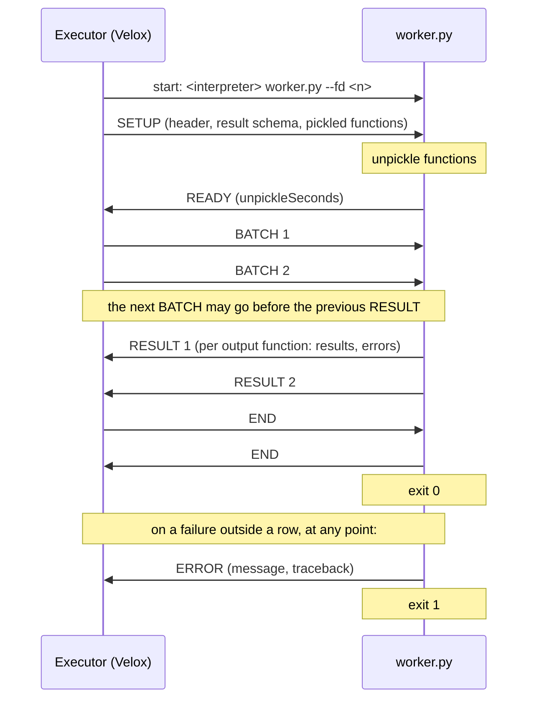

# Python worker protocol

Velox runs Python functions in separate worker processes. The PythonCall
operator's executor starts `worker.py` in the query's Python environment and
exchanges Arrow batches with it. This document defines that exchange and how
Velox values map to Python values.

## One worker, several functions

A worker runs every function of one PythonCall node, sharing one data stream:

- Each input batch goes to the worker once. A column several functions read,
  or one function reads twice, is sent once; each function names the columns
  it reads by index.
- A function can read another function's results, as `f(g(x))` does. The
  worker computes `g` and passes its results to `f` without a round trip
  through Velox. Only the functions the node outputs return results.
- The worker runs each entry of `functions` at most once per row, and does
  not look for duplicates. The executor lists each distinct call once: a call
  that several functions read, or that is both read and output, as `f(a)` in
  `f(a), g(f(a))`, is one entry.
- A worker runs in one Python environment, so functions that need different
  environments run in different workers.

## Launch

The executor creates a Unix socket pair and starts the worker with one end
inherited:

```
<interpreter> worker.py --fd <n>
```

`<interpreter>` comes from the resolver for the PythonCall node's environment
URI: a Python interpreter, version 3.10 or later, or a program that acts as
one. It must run `worker.py` as `__main__` with pyarrow importable (the tests
run pyarrow 18), and pyspark for ROW arguments (see PySpark functions). The
socket closes when the worker exits. User code's stdout and stderr are
separate from the socket; the executor logs them.

## Messages

Every message is a 1-byte type, an 8-byte little-endian payload length, and
the payload.

| Type | Value | Direction | Payload |
| --- | --- | --- | --- |
| `SETUP` | 1 | to worker | the functions to run; see below |
| `READY` | 2 | to executor | JSON: `{"unpickleSeconds": ...}` |
| `BATCH` | 3 | to worker | an Arrow IPC stream with one record batch: the argument columns |
| `RESULT` | 4 | to executor | an Arrow IPC stream with one record batch: the results |
| `ERROR` | 5 | to executor | JSON: `{"message": ..., "traceback": ...}` |
| `END` | 6 | both | empty |

The executor sends `SETUP`, and the worker answers `READY`. Then each `BATCH`
is answered by one `RESULT`, in order. The executor may send the next `BATCH`
before reading the previous `RESULT`, but must keep reading while it writes:
the worker writes each `RESULT` before it reads the next `BATCH`, so an
executor that only writes deadlocks once both sockets' buffers fill. The
executor sends `END`; the worker answers `END` and exits with status 0.



### SETUP

The payload is a sequence of sections, each a 4-byte little-endian length and
its bytes:

1. A JSON header:

   ```json
   {
     "protocolVersion": 1,
     "pythonVersion": "3.12",
     "sessionTimeZone": "America/Los_Angeles",
     "functions": [
       {"name": "g", "arguments": [{"column": 0}], "output": false},
       {"name": "f", "arguments": [{"function": 0}, {"column": 1}], "output": true}
     ]
   }
   ```

   - `pythonVersion`: the major.minor version the functions were pickled with.
   - `sessionTimeZone`: the time zone for timestamps, an IANA name or a fixed
     offset such as `+05:45`; see below.
   - `functions`: in an order where each function comes after the functions
     it reads. Per function:
     - `name`: for error messages.
     - `arguments`: per argument, a column of `BATCH` by index, or the results
       of an earlier function by its index in `functions`.
     - `output`: whether `RESULT` returns its results; true if absent. At
       least one function must be an output.
2. An Arrow IPC schema with one field per function, in order: the result
   types. Field names are ignored.
3. One section per function, in order: the pickled function.

A pickled function is a pickle stream of a callable, or of a tuple whose first
item is the callable; cloudpickle writes such streams for any function,
including lambdas and closures. Unpickling imports the modules the function
references, so `READY` reports how long it took.

The worker answers `ERROR` when `SETUP`:

- is malformed: a truncated section, a header or function without a required
  key, counts of functions, result types and pickled functions that differ, an
  argument that is not exactly one of `column` or `function`, a negative
  column, or an `output` that is not true or false;
- has a protocol or Python version other than the worker's, or an unknown
  session time zone;
- has a function that reads itself or a later function, or no output
  function;
- has a function that reads another function's ROW results, at any depth,
  when pyspark is not installed;
- has a pickled function that fails to unpickle, which the error names, or is
  not a callable;
- has a result type that is not in the table below, or a MAP whose keys
  contain a MAP at any depth.

### BATCH and RESULT

A `RESULT` has as many rows as its `BATCH`, including a `BATCH` with no
columns, which functions without arguments use. It has two columns per output
function, in `functions` order:

- the result, of the declared type; NULL where the call failed;
- the error, VARCHAR (Arrow utf8): NULL where the call succeeded; where it
  failed, the error message. In each batch, the function's first row that
  raised also carries the traceback.

Columns are read by position; their names carry no meaning.

The time each function spent on the batch travels in the Arrow schema's
custom metadata, the string-to-string map the IPC stream carries before the
record batch. Its key `functionWallSeconds` holds a JSON array of wall-clock
seconds, one per function in `functions` order, output or not, such as
`[0.0012, 0.0003]`. A function's time covers calling it, building its
results, and, when later functions read them, converting them to Python
values. The `BATCH` columns are converted once, outside these times.

A call fails its row, and only its row, when:

- the function raises any exception, including `SystemExit`;
- it returns a value that is not of the declared type (see below);
- an argument has no Python value, alone or inside an array, map or row: a
  DATE or TIMESTAMP outside the years 1 to 9999, a VARCHAR that is not valid
  UTF-8, which Velox does not check, or a MAP with keys that differ in Velox
  but are equal in Python: the two 01:30s on the night clocks fall back, or
  timestamps within a microsecond;
- an argument is the result of an earlier function that failed on the row.
  The error names that function and carries its whole error, with the
  traceback where it has one.

The worker calls the function on the remaining rows. Whether a failed row
fails the query is the operator's decision.

### ERROR

`ERROR` reports a failure outside a row, after which the worker exits with
status 1:

- `SETUP` as above;
- a malformed or unexpected message;
- a `BATCH` that is not exactly one record batch, has too few columns for the
  functions' arguments, or has a column a function reads whose type is not in
  the table below, or holds a ROW at any depth when pyspark is not installed;
- an exception in the worker itself.

The worker checks a `BATCH` before calling any function on it, and converts
only the columns functions read. A worker that exits without sending `ERROR`,
such as from a crash in native code, has failed for a reason only its exit
status and stderr show.

## Values

Each Velox type maps to an Arrow type in `BATCH` and `RESULT`, and to the
Python value a function receives. A result must be a value of the declared
type: what the argument would be, or one of the few other types listed. Error
messages name types as Velox does.

| Velox type | Arrow type | Argument | Result: the argument's type, or |
| --- | --- | --- | --- |
| BOOLEAN | bool | `bool` | |
| TINYINT, SMALLINT, INTEGER, BIGINT | int8, int16, int32, int64 | `int` | (must be within the type's range) |
| REAL, DOUBLE | float, double | `float` | `int` within ±2^53 (for REAL, ±2^24); for REAL, a `float` must be within its range |
| VARCHAR | utf8, large_utf8 | `str` | (must be valid UTF-8) |
| VARBINARY | binary, large_binary | `bytearray` | `bytes` |
| DATE | date32 | `datetime.date` | (not `datetime`) |
| TIMESTAMP | timestamp of any unit, without a time zone | naive `datetime.datetime` in the session time zone, to the microsecond | a `datetime` with a time zone; must not be more precise than the unit |
| DECIMAL | decimal128 | `decimal.Decimal` | (must fit the precision and scale) |
| ARRAY | list, large_list | `list` | `tuple` |
| MAP | map | `dict` | (keys must not be `None`) |
| ROW | struct | `pyspark.sql.Row` | `tuple` by position; `dict` by field name, missing fields NULL and extra fields an error |

- Arrays must be plain: dictionary, view and run-end encodings are not
  accepted. MAP keys must not contain a MAP, which Python cannot hash.
- The worker does not check that a MAP result's keys are distinct in Velox:
  keys distinct in Python can be equal once stored, such as REAL keys or
  timestamps in seconds, and equality is Velox's to decide. The executor
  checks them.
- Elements, keys, values and fields follow the same rules.
- A map key argument whose value is a `list` or `bytearray` arrives as a
  `tuple` or `bytes`, so that it is hashable.
- ROW values are built by position, so empty and repeated field names work.
  A `Row` result is read by position when its field names are the declared
  ones, as for a ROW argument passed back, and by name otherwise. A ROW type
  with repeated field names takes only results by position.
- `None` is NULL for every type, except as a map key.
- A function reading another function's results receives them as they would
  arrive through Velox: a DOUBLE result returned as `7` arrives as `7.0`.
- Timestamps are converted with the session time zone in both directions. The
  worker leaves the process's own time zone alone, so `datetime.now()` in user
  code returns the host's local time.

## PySpark functions

The protocol is not tied to Spark: any pickled callable runs. PySpark's plain
UDFs fit it as they are, so a Spark Connect server can pass them to the worker
unchanged:

- Spark's `PythonUDF.command` is a pickle of the tuple
  `(function, return type)`, one of the two forms of a pickled function.
- Two entries in the value table follow PySpark, so its functions see the
  values they expect: VARBINARY is `bytearray`, and ROW is `pyspark.sql.Row`, a
  tuple whose fields are reachable by name and by position.

The worker needs pyarrow, and pyspark in two cases:

- A function reads a ROW, from a column or another function, since ROW
  arguments arrive as `pyspark.sql.Row`. The worker checks this by type, in
  `SETUP` for function results and in each `BATCH` for columns, and answers
  `ERROR` without pyspark.
- The functions were pickled by PySpark, which pickles with its own copy of
  cloudpickle and a `pyspark.sql.types` return type.

The worker imports pyspark on first use, so functions without ROW arguments
start without it.

## Tests

`tests/test_worker.py` drives the worker over a socket pair, without starting
a process. The tests need pyarrow and pyspark.
